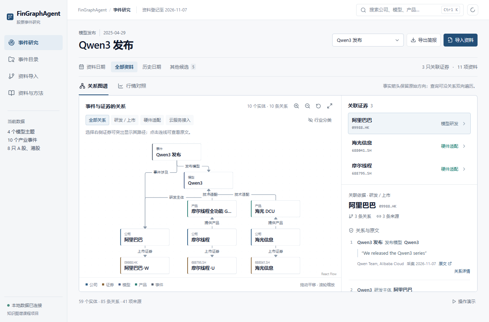

# FinGragh Agent

面向人工智能产业股票的金融研究 Agent。当前覆盖大模型与算力相关公司，支持业务关系核查、财务比较与行情查询；后续重点接入股票筛选、预测模型和量化回测。

终端基于 Pi，采用暖金色像素标识；金融工具通过 MCP 接入，Web 用于查看关系、事件和原文证据。量化部分计划复用 Qlib，检验图谱关系能否为 AI 股票分析与预测带来增益。



## 快速开始

需要 Python 3.11+、Node.js 22.19+。在 Windows 项目根目录安装依赖：

```powershell
.\fingraph.cmd -Setup
```

首次使用，将 `.env.example` 复制为 `.env`，填写 `LLM_API_KEY`。当前终端版本使用 OpenCode Go 的 `deepseek-v4.1-flash`；密钥只保存在本地。

```powershell
.\fingraph.cmd -Check   # 检查本地配置，不调用模型
.\fingraph.cmd          # 启动终端和 Web
```

Pi、Python 环境、会话及配置均放在项目目录。退出终端时，启动器会关闭由它启动的 Web 服务。

## 试着问

```text
对比海光信息与浪潮信息最近两个报告期的营业收入和归母净利润。
寒武纪和中芯国际分别处于芯片产业链的哪一环？请给出财报依据。
腾讯控股最近十个交易日的行情覆盖到哪一天？
GLM-5 的研发主体与云服务接入方有什么区别？
```

输入 `/web` 打开图谱；查询过事件后，网页会选中对应事件。输入 `/usage` 查看模型测试用量。

## 数据与功能

当前图谱包含 86 个实体、106 条关系、10 个产业事件，覆盖 DeepSeek-R1、Qwen3、GLM-5、MiniMax-M2.5 及相关公司。事件关联和公司产品关系保留原文、来源与披露日期。

财报语料已扩到 40 家公司、96 份去重文档，包括芯片、晶圆代工、服务器、光互联、数据中心及云服务。PDF 已完成全文解析，公开[资料目录](data/corpus/)保留链接、内容校验和日期；目前先从主营段落抽取并审核关系，整批财报尚未全部入图。

新增金融样本覆盖海光信息、浪潮信息、中科曙光、阿里巴巴和腾讯：

| 资料 | 已整理内容 |
|---|---|
| 财务指标 | 206 条报告期记录，保留币种、单位、指标定义和日期 |
| 主营构成 | 483 条记录，覆盖 3 家 A 股公司 |
| 日行情 | 5 只股票 2,243 行，另有沪深 300 指数 449 行 |
| 财报语料 | 96 份年报及中报，覆盖 40 家公司；PDF 和解析正文保存在本地 |

财务聚合表是当前快照，历史修订版本尚未补齐。MCP 按资料版本的可用日期过滤查询；当前版本主要用于研究已有资料，研究笔记的跨会话记忆、严格历史回放、预测评估和 Agent/RAG 对照实验仍在开发。[开发计划](docs/ROADMAP.md)记录后续范围、开源参考与验收标准。

## 项目目录

| 路径 | 内容 |
|---|---|
| [code/agent/](code/agent/) | 项目内终端入口、Pi 扩展与用量记录 |
| [code/](code/) | 知识抽取、图谱查询、金融数据、MCP 与 Web API |
| [data/](data/) | 图谱与证据；[corpus/](data/corpus/) 为财报目录，[finance/](data/finance/) 为财务与行情样本 |
| [visualization/](visualization/) | React、React Flow 和 ECharts 可视化 |
| [docs/](docs/) | 开发计划、方法与实验；[开发说明](docs/DEVELOPMENT.md)包含检查命令 |

## 课程材料

[期中汇报](docs/presentation/FinGraph-期中汇报.pdf) · [讲稿](docs/presentation/TALK.md) · [构建方法](docs/METHOD.md)

以下视频展示期中图谱原型：

https://github.com/user-attachments/assets/ec6aabb3-9543-4a88-8c19-6920ac20c110
